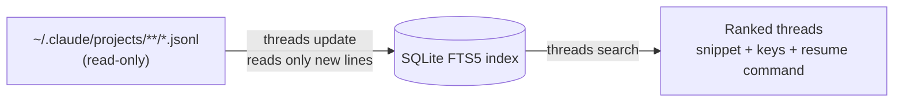

# thread-search

**Find any past Claude Code conversation in milliseconds.**

[](#license)
[](https://www.rust-lang.org)
[](#install)
[](#privacy)

`threads` keeps a local SQLite full-text index of your Claude Code threads. It searches every
message fast enough to run on each key press, ranks the threads, and prints the command that
resumes each one.


<sub>The demo uses fake threads from [`demo/make_demo.py`](demo/make_demo.py).</sub>

## Features

- **Full text.** Searches every user and assistant message, the thread title, the folder name, and the git branch.
- **Fast.** 5 to 10 ms for a typical search over 1,800 threads and 65,000 messages. See [Performance](#performance).
- **Search as you type.** The last word matches as a prefix from one letter, so `deplo` finds `deployment`.
- **Ranked.** Threads that match every word come first. Title hits and exact words rank higher.
- **Ticket keys.** Takes keys such as `ABC-123` from your prompts, thread titles, and branch names like `fix/abc-123-login`.
- **One-step resume.** Each result prints `cd <folder> && claude --resume <id>`. A moved project folder is found again ([one exception](docs/measurements.md#slug-rule-on-a-long-path)).
- **Scriptable.** `--json` prints a stable [JSON contract](docs/json.md) for editors, launchers, and TUIs.
- **Incremental.** `threads update` reads only the new lines of each transcript. A no-change update takes about 26 ms.
- **Private.** No network code. Transcripts are opened read-only. The index is readable by your user only.

## Install

You need Rust 1.100 or later.

```sh
cargo install --git https://github.com/BryanLe80/thread-search-oss
```

Or build from a clone:

```sh
git clone https://github.com/BryanLe80/thread-search-oss
cd thread-search-oss
cargo install --path .
```

Both put the `threads` binary in `~/.cargo/bin`. The default index path is for macOS. On other
systems, set `THREADS_INDEX` (see [Where things live](#where-things-live)).

## Quick start

```sh
threads update                     # build the index (a few seconds the first time)
threads search retry backoff       # every word must match; the last word is a prefix
threads search ABC-123             # find the threads for a ticket
threads search --json --limit 5 -- deploy   # machine-readable output
threads stats                      # thread count, message count, index size, last update
```

`search` does not update the index. Run `threads update` first, for example from a shell hook or
a launcher. The full query rules (prefixes, quotes, ranking) are in
[docs/search.md](docs/search.md).

## Performance

Search times are medians on an Apple M5 Max with a real history: 1,813 threads and 65,411
messages from 12 GB of transcripts.

| Query | `threads search` | ripgrep over the same transcripts |
| --- | --- | --- |
| One word (`deployment`) | **5.0 ms** | 148.7 ms |
| Two words (`migration rollback`) | **6.3 ms** | 242.6 ms |
| Three ordinary words | **9.5 ms** | |
| Three very common words (`the and to`) | 30.1 ms | |

ripgrep scans every file on every query and lists files, not ranked threads. `threads` reads each
transcript once and then answers from the index, 30 to 38 times faster on this history.

From an earlier run on the same history (1,809 threads):

| Operation | Result |
| --- | --- |
| `threads update`, nothing changed | 26 ms median |
| `threads rebuild`, full index | 3.3 s, about 25 MB peak memory |
| `threads search` peak memory | 9 to 10 MB |
| Index size | 89 MB |
| Binary size (release, stripped) | 2.3 MB |

The method and the full results are in [docs/measurements.md](docs/measurements.md).

## How it works



1. `threads update` walks the transcript folder. It skips unchanged files, reads only the appended
   lines of grown files, and reads a file again only when it was rewritten.
2. Each thread gets one row with its title, folder, branch, and ticket keys. Each message goes into
   an FTS5 table with a `unicode61` tokenizer and no stemmer.
3. `threads search` runs one FTS5 query, ranks the threads, and marks the matched words in a snippet.

Threads that scripts start (`claude -p`, the Agent SDK) are left out.

## Comparison

| Tool | Searches every message | Persistent index | Ranked | Ticket keys | JSON | Interface |
| --- | --- | --- | --- | --- | --- | --- |
| **thread-search** | ✅ | ✅ SQLite FTS5 | ✅ | ✅ | ✅ | CLI |
| [fast-resume](https://github.com/angristan/fast-resume) | ✅ | ✅ Tantivy | ✅ | ➖ | ✅ | TUI, many agents |
| [agf](https://github.com/subinium/agf) | ❌ name, path, branch | ❌ | partial (fuzzy) | ➖ | ✅ | TUI, many agents |
| [claude-code-history-viewer](https://github.com/jhlee0409/claude-code-history-viewer) | partial | ❌ | ➖ | ➖ | ✅ export | Desktop app |
| [claude-historian-mcp](https://github.com/Vvkmnn/claude-historian-mcp) | partial (fuzzy) | ❌ in memory | ✅ | ➖ | ✅ | MCP server for Claude |
| Claude Code `/resume` | ❌ title, summary, first prompt | n/a | ❌ | ❌ | ❌ | Built in |
| `rg` over `~/.claude/projects` | ✅ | ❌ | ❌ | ❌ | ✅ | CLI |

✅ yes · ❌ no · ➖ not documented. Data for other tools comes from their READMEs and docs on
2026-11-13. If a row is wrong, please open an issue.

**When to pick another tool.** Use fast-resume or agf for one picker over many agents (Codex,
Gemini, and others). Use claude-code-history-viewer to browse threads in a desktop app. Use
claude-historian-mcp to let Claude search its own history. Use `threads` for the fastest full-text
search over Claude Code threads, ticket lookups, and a JSON feed for your own tools.

## Where things live

| Item | Default | Override |
| --- | --- | --- |
| Transcripts (read only) | `~/.claude/projects` | `THREADS_ROOT` |
| Index | `~/Library/Application Support/thread-search/index.db` | `THREADS_INDEX` |

The tool writes the index and its `-wal`, `-shm`, and `.lock` companions, nothing else. It
also writes `index.db.bad` when the index file is unreadable. The newest unreadable file
replaces an older `.bad`.

## Privacy

- No network access. The tool has no network code and adds no dependency for it.
- The transcript folder is opened read-only.
- Index files are created with mode 0600, so only your user can read them. The index holds
  the text of your conversations; do not share or commit it.

## FAQ

**Old threads are missing.** Claude Code deletes transcripts after 30 days by default. Raise
`cleanupPeriodDays` in your Claude Code settings to keep more history searchable. The index drops
a thread when its transcript is deleted.

**A Claude Code update changed the transcripts.** The transcript format is internal to Claude Code
and can change between versions. If results look wrong after an update, run `threads rebuild` and
open an issue.

**How do I delete the index?** Run `threads rebuild` to delete it and build it again. To delete it
by hand, first make sure that no `threads` process runs. Then delete only these files. The
commands use the default macOS path. If you set `THREADS_INDEX`, delete that file and its `-wal`
and `-shm` files instead.

```sh
rm -f ~/Library/Application\ Support/thread-search/index.db \
      ~/Library/Application\ Support/thread-search/index.db-wal \
      ~/Library/Application\ Support/thread-search/index.db-shm
```

Do not delete `index.db.lock`. `threads update` builds the index again from the transcripts.

A new index carries an SQLite `application_id` stamp. The tool refuses a database that is not
empty and is not a thread-search index, and leaves it untouched. A thread-search index has the
stamp. An index built before the stamp has a `meta` table with a `schema_version` of 1 or 2 and a
`threads` table. The tool renames a file that SQLite cannot read as a database to
`index.db.bad` and builds a new index. The schema version is 3.

## Documentation

- [Commands and search syntax](docs/search.md)
- [JSON output](docs/json.md)
- [Measurements](docs/measurements.md)

## Contributing

Issues and pull requests are welcome.

```sh
cargo test
cargo clippy --all-targets -- -D warnings
```

## License

Licensed under either of [Apache License, Version 2.0](LICENSE-APACHE) or
[MIT license](LICENSE-MIT), at your option.

Unless you explicitly state otherwise, any contribution you submit for inclusion in this project,
as defined in the Apache-2.0 license, is dual licensed as above, without any additional terms or
conditions.
